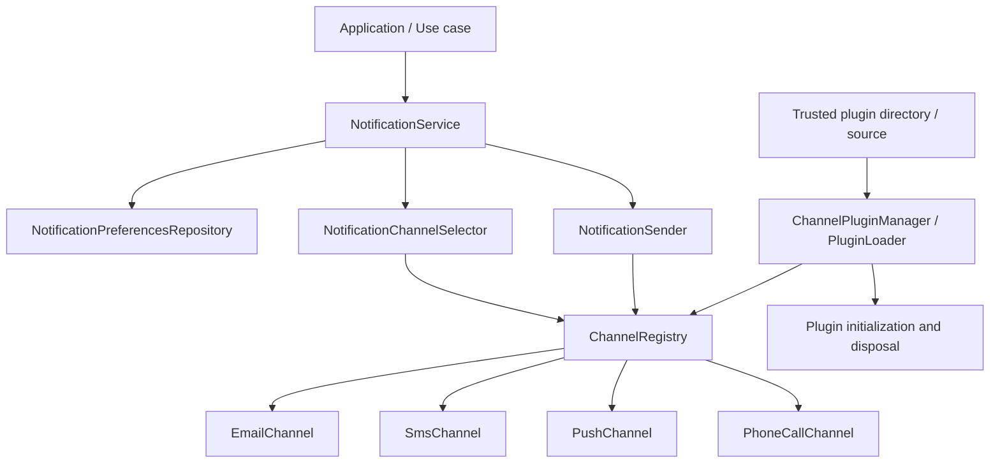
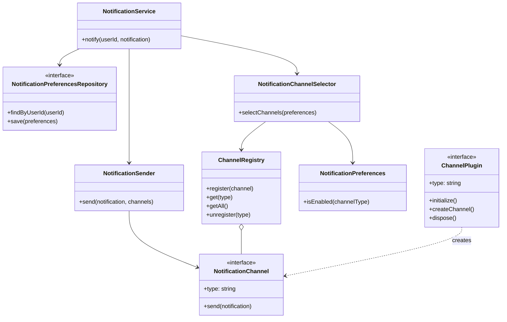
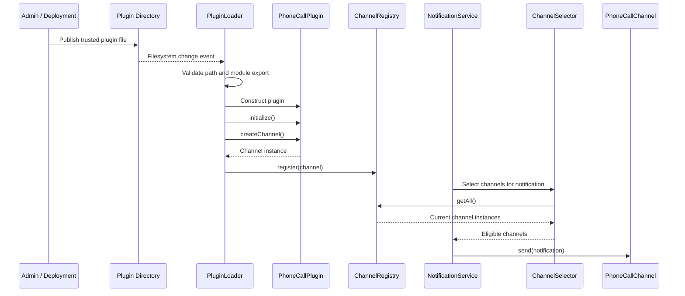

# Runtime-Extensible Notification System — OOP Design

## Table of contents

1. [Problem statement](#1-problem-statement)
2. [Requirements](#2-requirements)
3. [Core concepts](#3-core-concepts)
4. [Architecture diagram](#4-architecture-diagram)
5. [Main OOP relationships](#5-main-oop-relationships)
6. [Domain model and contracts](#6-domain-model-and-contracts)
7. [Persistence design](#7-persistence-design)
8. [Channel registry](#8-channel-registry)
9. [Channel selection](#9-channel-selection)
10. [Sender and application service](#10-sender-and-application-service)
11. [Runtime plugin contract](#11-runtime-plugin-contract)
12. [Dynamic JavaScript module loading in Node.js](#12-dynamic-javascript-module-loading-in-nodejs)
13. [What about TypeScript plugins?](#13-what-about-typescript-plugins)
14. [Runtime addition sequence](#14-runtime-addition-sequence)
15. [OOP principles and patterns](#15-oop-principles-and-patterns)
16. [Production concerns and trade-offs](#16-production-concerns-and-trade-offs)
17. [Interview summary](#17-interview-summary)

---

## 1. Problem statement

Design a notification system that can deliver notifications through **multiple channels**:

- 📧 **Email**
- 💬 **SMS**
- 📱 **Push notifications**
- 📞 **Phone calls**
- ➕ **Future channels** — added *without changing* the core notification workflow

The system should let users **subscribe to channels**, select **only eligible channels** for a given notification, and support **adding a new channel implementation while the Node.js application is running**.

> **Focus:** object-oriented design, responsibilities, interfaces, extensibility, and runtime module loading — **not** provider-specific delivery details.

---

## 2. Requirements

### Functional requirements

1. A user can **enable or disable** notification channels.
2. The application can send a notification through **one or multiple eligible channels**.
3. A channel can be added **without modifying** `NotificationService`, `NotificationSender`, or the selector.
4. The application can **discover and load a new trusted plugin at runtime**.
5. The system can handle **missing preferences**, **unavailable channels**, **invalid plugins**, and **plugin-loading failures**.
6. The design can later support **preferences per notification category**, such as `order-updates` and `security-alerts`.

### Non-functional requirements

| Requirement | Meaning |
| --- | --- |
| **Extensibility** | New channel implementations conform to a **stable contract**. |
| **Separation of concerns** | Preferences, selection, delivery, persistence, and plugin lifecycle are **separate responsibilities**. |
| **Testability** | Business logic depends on **interfaces**, so components can be tested with fakes. |
| **Safety** | A new plugin is **validated and initialized** before it replaces a working channel. |
| **Operational clarity** | Registration and loading failures are **logged and observable**. |

---

## 3. Core concepts

| Concept | Responsibility |
| --- | --- |
| `Notification` | Represents the communication to deliver and its recipient/context. |
| `Recipient` | Identifies the destination information needed for delivery. |
| `NotificationContent` | Represents the logical message content. |
| `NotificationPreferences` | Represents a user's enabled channels, optionally per notification category. |
| `NotificationPreferencesRepository` | Loads and saves preferences. |
| `NotificationChannel` | **Contract** implemented by every delivery channel. |
| `ChannelRegistry` | Stores currently available channel instances by channel ID. |
| `NotificationChannelSelector` | Chooses registered channels permitted by the user's preferences and notification rules. |
| `NotificationSender` | Invokes the selected channels. |
| `NotificationService` | Coordinates the application use case. |
| `ChannelPlugin` | Optional lifecycle contract for a dynamically loaded extension. |
| `ChannelPluginManager` / `PluginLoader` | Discovers, loads, validates, initializes, registers, replaces, and removes plugins. |

> 💡 **Key idea:** A notification is **not** a channel.
> The notification describes **what** to communicate; the channel describes **how** to deliver it.

---

## 4. Architecture diagram



The application core uses **stable abstractions**. The **plugin loader** is responsible for making new implementations available to the **registry**.

---

## 5. Main OOP relationships



---

## 6. Domain model and contracts

The following TypeScript snippets describe the contracts and core logic. They are **illustrative**; they can be split into separate files in a real project.

### Channel IDs

❌ **Avoid** a fixed union such as:

```ts
type ChannelType = "email" | "sms" | "push";
```

A fixed union means adding `phone-call` requires **changing and recompiling the core application**.

✅ For a runtime-extensible system, use a **validated dynamic ID**:

```ts
export type ChannelId = string;
```

> In production, **validate IDs** against a rule such as lowercase kebab-case and **reject blank or duplicate IDs**.

### Notification and channel contract

```ts
export interface Notification {
  readonly id: string;
  readonly recipient: {
    readonly userId: string;
    readonly email?: string;
    readonly phoneNumber?: string;
    readonly deviceTokens?: readonly string[];
  };
  readonly category: string;
  readonly title?: string;
  readonly body: string;
  readonly metadata?: Readonly<Record<string, unknown>>;
}

export interface NotificationChannel {
  readonly type: string;

  send(notification: Notification): Promise<void>;
}
```

A **shared logical notification** is a good starting point. If channels require significantly different payloads — HTML email, SMS length constraints, push deep links — each channel can **map the logical notification to a channel-specific message model**.

### Preferences

```ts
export class NotificationPreferences {
  constructor(
    public readonly userId: string,
    private readonly enabledChannels: ReadonlySet<string>,
    // Optional: category -> enabled channel IDs
    private readonly channelsByCategory?: ReadonlyMap<
      string,
      ReadonlySet<string>
    >
  ) {}

  isEnabled(channelId: string, category?: string): boolean {
    if (category && this.channelsByCategory) {
      const categoryChannels = this.channelsByCategory.get(category);
      return categoryChannels?.has(channelId) ?? false;
    }

    return this.enabledChannels.has(channelId);
  }
}
```

The example supports either **general** channel preferences or **category-specific** preferences.

> ⚠️ A production model should **define precedence explicitly** — for example, category-specific settings override global defaults.

---

## 7. Persistence design

A normalized relational representation can use a `user_notification_preferences` table:

| user_id | notification_category | channel_id | enabled |
| --- | --- | --- | --- |
| 123 | `*` | `email` | true |
| 123 | `*` | `sms` | false |
| 123 | `*` | `push` | true |
| 123 | `security-alerts` | `phone-call` | true |

**Suggested constraints:**

- **Unique key:** `(user_id, notification_category, channel_id)`.
- **Reserved category** such as `*` represents a global/default preference.
- **Foreign key** to the user table.
- **Optional foreign key** to a channel catalogue if channels are centrally managed in the database.

**Key points:**

- The channel ID should **not** be restricted to a compile-time TypeScript union. Adding a channel should **not require a database schema change**.
- Keep contact destinations and device registrations in appropriate user/contact/device tables. A preference says whether a channel is **enabled**; it does **not** prove that a destination exists, is verified, or is valid.
- If the product doesn't need category-specific preferences, start with just `(user_id, channel_id, enabled)`.

### Repository abstraction

```ts
export interface NotificationPreferencesRepository {
  findByUserId(
    userId: string
  ): Promise<NotificationPreferences | null>;

  save(preferences: NotificationPreferences): Promise<void>;
}
```

A SQL/ORM implementation belongs **outside the domain model**. `NotificationService` should **not issue SQL directly**.

---

## 8. Channel registry

The registry is the **in-memory catalogue of currently active channel objects**. It is **not** a plugin loader; it only manages registrations.

```ts
import type { NotificationChannel } from "./notification-channel.js";

export class ChannelRegistry {
  #channels = new Map<string, NotificationChannel>();

  register(channel: NotificationChannel): void {
    const type = channel.type;

    if (!type || !/^[a-z][a-z0-9-]*$/.test(type)) {
      throw new Error(`Invalid channel type: ${type}`);
    }

    if (this.#channels.has(type)) {
      throw new Error(`Channel already registered: ${type}`);
    }

    this.#channels.set(type, channel);
  }

  // Use only when replacing an existing channel intentionally.
  replace(channel: NotificationChannel): NotificationChannel | undefined {
    const type = channel.type;

    if (!type || !/^[a-z][a-z0-9-]*$/.test(type)) {
      throw new Error(`Invalid channel type: ${type}`);
    }

    const previous = this.#channels.get(type);
    this.#channels.set(type, channel);
    return previous;
  }

  get(type: string): NotificationChannel | undefined {
    return this.#channels.get(type);
  }

  getAll(): NotificationChannel[] {
    return [...this.#channels.values()];
  }

  unregister(type: string): NotificationChannel | undefined {
    const channel = this.#channels.get(type);
    this.#channels.delete(type);
    return channel;
  }
}
```

**Design notes:**

- `register` **rejects duplicate IDs** rather than silently overwriting a live implementation.
- `replace` is **explicit** and **returns the old object** so the caller can dispose of it.
- `getAll()` returns a **copy** of the array, not the internal map.
- A production registry may track plugin **ownership, health, version, status, and in-flight sends**.
- Unregistering a channel does **not** automatically cancel work already using that channel.

---

## 9. Channel selection

The selector chooses only channels that are **both registered _and_ enabled** in the user's preferences.

```ts
import type { ChannelRegistry } from "./channel-registry.js";
import type { NotificationPreferences } from "./notification-preferences.js";
import type { Notification } from "./notification.js";
import type { NotificationChannel } from "./notification-channel.js";

export class NotificationChannelSelector {
  constructor(private readonly registry: ChannelRegistry) {}

  selectChannels(
    preferences: NotificationPreferences,
    notification: Notification
  ): NotificationChannel[] {
    return this.registry.getAll().filter(channel =>
      preferences.isEnabled(channel.type, notification.category)
    );
  }
}
```

> ❓ **Policy question:** what happens if a user has enabled a channel that is **currently unavailable**?
>
> This selector naturally **omits unregistered channels**. The application should **log/measure** the unavailable preference or report it through an operational status mechanism — **rather than pretending delivery occurred**.

> ⚠️ For **compliance-sensitive channels**, add a separate **eligibility/consent policy**; a preference alone may not be sufficient authorization to send.

---

## 10. Sender and application service

The sender **delivers through channels already selected by policy**. It should **not** query the database or decide user preferences.

```ts
import type { Notification } from "./notification.js";
import type { NotificationChannel } from "./notification-channel.js";

export class NotificationSender {
  async send(
    notification: Notification,
    channels: NotificationChannel[]
  ): Promise<void> {
    const results = await Promise.allSettled(
      channels.map(channel => channel.send(notification))
    );

    const failures = results
      .map((result, index) => ({ result, channel: channels[index] }))
      .filter(item => item.result.status === "rejected");

    if (failures.length > 0) {
      // Production code should record channel-specific failures.
      // Whether to throw, retry, or return a result is a domain decision.
      throw new Error(
        `${failures.length} notification channel(s) failed`
      );
    }
  }
}
```

`Promise.allSettled` **waits for every channel attempt**, rather than stopping at the first rejection. In production, return a **structured per-channel result** instead of throwing a generic error, and apply **retry/idempotency policies** where appropriate.

The **service coordinates the use case:**

```ts
export class NotificationService {
  constructor(
    private readonly preferencesRepository: NotificationPreferencesRepository,
    private readonly selector: NotificationChannelSelector,
    private readonly sender: NotificationSender
  ) {}

  async notify(notification: Notification): Promise<void> {
    const preferences =
      await this.preferencesRepository.findByUserId(
        notification.recipient.userId
      );

    if (!preferences) {
      // Explicit default: no preferences means send nothing.
      return;
    }

    const channels = this.selector.selectChannels(
      preferences,
      notification
    );

    if (channels.length === 0) {
      return;
    }

    await this.sender.send(notification, channels);
  }
}
```

### Responsibility boundaries

| Component | Responsibility |
| --- | --- |
| `NotificationService` | Coordinates the use case |
| `NotificationPreferencesRepository` | Persistence |
| `NotificationChannelSelector` | Preference-based selection |
| `NotificationSender` | Invokes selected channels |
| `NotificationChannel` | Channel-specific delivery |
| `ChannelRegistry` | Tracks currently registered implementations |
| `PluginLoader` / `ChannelPluginManager` | Loads and manages extensions |

---

## 11. Runtime plugin contract

The **channel interface** describes **delivery**. A **plugin contract** can describe **lifecycle operations** as well.

```ts
import type { NotificationChannel } from "./notification-channel.js";

export interface ChannelPlugin {
  readonly type: string;

  initialize(): Promise<void>;

  createChannel(): NotificationChannel;

  dispose(): Promise<void>;
}
```

Example plugin module, `plugins/phone-call-plugin.js`:

```js
class PhoneCallChannel {
  get type() {
    return "phone-call";
  }

  async send(notification) {
    console.log(
      `[PHONE CALL] recipient=${notification.recipient.phoneNumber}`,
      notification.body
    );
  }
}

export default class PhoneCallPlugin {
  type = "phone-call";

  async initialize() {
    // Initialize a trusted provider client or other resources.
  }

  createChannel() {
    return new PhoneCallChannel();
  }

  async dispose() {
    // Close clients and release resources.
  }
}
```

The module **exports a plugin class**, not a pre-registered global singleton. This lets the **host control initialization, registration, and cleanup**.

---

## 12. Dynamic JavaScript module loading in Node.js

The following example uses **native ES modules** and **dynamic `import()`**.

> **Prerequisites:** the project should use `"type": "module"` in `package.json` (or an equivalent ESM setup). Plugin files must be **JavaScript that Node can execute**.

### `plugin-loader.js`

```js
import { readdir } from "node:fs/promises";
import path from "node:path";
import { pathToFileURL } from "node:url";

export class PluginLoader {
  constructor(pluginDirectory, registry) {
    this.pluginDirectory = path.resolve(pluginDirectory);
    this.registry = registry;
    this.plugins = new Map();
  }

  async loadFile(filename) {
    // Only load files with the expected plugin extension.
    if (!filename.endsWith(".plugin.js")) return;

    const absolutePath = path.resolve(
      this.pluginDirectory,
      filename
    );

    // Prevent path traversal outside the plugin directory.
    if (
      path.dirname(absolutePath) !== this.pluginDirectory
    ) {
      throw new Error("Plugin path is outside the plugin directory");
    }

    const moduleUrl = pathToFileURL(absolutePath);

    // A unique query string requests a fresh module evaluation.
    // This does not unload old modules or clean up old instances.
    moduleUrl.searchParams.set("v", `${Date.now()}-${Math.random()}`);

    const module = await import(moduleUrl.href);
    const PluginClass = module.default;

    if (typeof PluginClass !== "function") {
      throw new Error(`${filename} must default-export a plugin class`);
    }

    const plugin = new PluginClass();

    if (
      typeof plugin.type !== "string" ||
      typeof plugin.initialize !== "function" ||
      typeof plugin.createChannel !== "function" ||
      typeof plugin.dispose !== "function"
    ) {
      throw new Error(`Invalid plugin contract: ${filename}`);
    }

    await plugin.initialize();

    const channel = plugin.createChannel();

    if (
      channel.type !== plugin.type ||
      typeof channel.send !== "function"
    ) {
      await plugin.dispose();
      throw new Error(`Invalid channel implementation: ${filename}`);
    }

    // First install must not silently overwrite a live channel.
    if (this.registry.get(plugin.type)) {
      await plugin.dispose();
      throw new Error(`Channel already registered: ${plugin.type}`);
    }

    try {
      this.registry.register(channel);
      this.plugins.set(plugin.type, plugin);
    } catch (error) {
      await plugin.dispose();
      throw error;
    }
  }

  async loadAll() {
    const files = await readdir(this.pluginDirectory);

    for (const filename of files) {
      await this.loadFile(filename);
    }
  }

  async unload(type) {
    const plugin = this.plugins.get(type);

    if (!plugin) return;

    // Stop new selection of this channel before disposing it.
    this.registry.unregister(type);
    this.plugins.delete(type);

    await plugin.dispose();
  }
}
```

> ⚠️ **This is a teaching example.** A hardened loader should:
>
> - **Serialize** concurrent operations for the same channel ID
> - **Validate** plugin paths and permissions
> - **Record** module versions
> - **Handle** failed initialization
> - **Coordinate** unloading with in-flight sends

### `channel-registry.js`

```js
export class ChannelRegistry {
  #channels = new Map();

  register(channel) {
    if (!channel?.type || typeof channel.send !== "function") {
      throw new Error("Invalid notification channel");
    }

    if (this.#channels.has(channel.type)) {
      throw new Error(`Channel already registered: ${channel.type}`);
    }

    this.#channels.set(channel.type, channel);
  }

  get(type) {
    return this.#channels.get(type);
  }

  getAll() {
    return [...this.#channels.values()];
  }

  unregister(type) {
    const channel = this.#channels.get(type);
    this.#channels.delete(type);
    return channel;
  }
}
```

### `app.js`

```js
import { watch } from "node:fs";
import path from "node:path";
import { ChannelRegistry } from "./channel-registry.js";
import { PluginLoader } from "./plugin-loader.js";

const pluginDirectory = path.resolve("./plugins");
const registry = new ChannelRegistry();
const loader = new PluginLoader(pluginDirectory, registry);

// Register plugins already present at startup.
await loader.loadAll();

console.log("Registered channels:", registry.getAll().map(c => c.type));

// Observe additions. fs.watch behavior differs across operating systems.
// In production, debounce events and verify that writes are complete.
const watcher = watch(pluginDirectory, (eventType, filename) => {
  if (!filename || !filename.toString().endsWith(".plugin.js")) return;

  const name = filename.toString();

  // Simple demo delay only—not a robust write-completion mechanism.
  setTimeout(() => {
    loader.loadFile(name).catch(error => {
      console.error(`Could not load ${name}:`, error);
    });
  }, 250);
});

process.on("SIGTERM", async () => {
  watcher.close();

  for (const channel of registry.getAll()) {
    try {
      await loader.unload(channel.type);
    } catch (error) {
      console.error(`Could not unload ${channel.type}:`, error);
    }
  }

  process.exit(0);
});
```

For a **real hot-reload system**:

- Handle `rename`/delete events
- **Debounce and deduplicate** events
- Wait for **atomic file publication**
- **Serialize** operations
- Define **replacement semantics**

> ⚠️ Do **not** treat `fs.watch` as a durable event stream.

### How to try it

1. Create the `plugins` directory.
2. Add `phone-call.plugin.js` implementing the plugin contract above.
3. Start the application with `node app.js`.
4. Add another trusted `*.plugin.js` file **while the process is running**.
5. Observe that the loader imports and registers it **without restarting** the application.

> 💡 For this to be truly dynamic, the notification service and selector must **consult the live registry at send time**, rather than keeping a one-time copy of the channel list.

---

## 13. What about TypeScript plugins?

There are two practical options:

1. ✅ **Recommended for production:** compile TypeScript plugins to JavaScript, then dynamically import the generated `.js` files.
2. ⚙️ **Direct TypeScript execution:** use a Node.js version and TypeScript feature set supported by its built-in **type stripping**, or a compatible runtime loader. This has **version and feature limitations**; do not assume every `tsconfig.json` transform will run.

**Notes:**

- The dynamic loader above expects **executable JavaScript files**. If TypeScript is compiled into a plugin output directory, **watch the output directory**, not the source directory.
- **Avoid importing a plugin before the compiler has finished writing its output.**
- Use the **same interface contract** for the host and plugins, and keep **shared type definitions versioned** so independently built plugins remain compatible with the host.

---

## 14. Runtime addition sequence



---

## 15. OOP principles and patterns

| Principle / Pattern | How it applies |
| --- | --- |
| **Abstraction** | `NotificationChannel` defines the delivery contract. |
| **Polymorphism** | Email, SMS, push, and phone-call implementations are invoked through the same interface. |
| **Dependency Inversion Principle** | High-level notification logic depends on abstractions, not provider-specific classes. |
| **Open/Closed Principle** | The core workflow stays unchanged as new channel implementations are added. |
| **Composition** | `NotificationService` receives its repository, selector, and sender dependencies. |
| **Strategy pattern** | Each channel is a delivery strategy. |
| **Registry / service catalogue** | `ChannelRegistry` manages the set of active implementations. |
| **Plugin architecture** | `PluginLoader` manages runtime discovery and lifecycle. |

> 💡 **A registry alone does not make the application hot-pluggable.** Runtime extensibility requires **discovery → module loading → validation → initialization → registration**, plus a **safe lifecycle** for replacement/removal.

---

## 16. Production concerns and trade-offs

### 🔒 Security

A Node.js module loaded with `import()` **executes with the privileges of the current process**.

> ⚠️ **Dynamic imports are not a sandbox.** Load only **trusted and authenticated** plugin artifacts. If plugins are not fully trusted, run them in **separate processes or services** with limited permissions.

### ⚛️ Atomic plugin installation

**Do not expose a plugin before initialization and validation succeed.** A safer replacement flow:

1. **Load** the new module.
2. **Validate** its manifest and contract.
3. **Initialize** it and run health checks.
4. **Atomically replace** the registry entry.
5. **Drain** — allow in-flight sends using the old instance to finish.
6. **Dispose** of the old plugin.

> If any step **before replacement** fails, **retain the existing channel**.

### 🔄 Concurrency and lifecycle

- Prevent **two concurrent loads** from registering the same ID.
- **Track** plugin instances and versions.
- **Don't dispose** of a channel while requests are using it.
- Define whether **removal is allowed** while notifications are in flight.
- Handle **partial startup and shutdown failures**.

### 📬 Delivery reliability

For production systems, consider:

- **Queues**
- **Retries with backoff**
- **Idempotency keys**
- **Provider rate limits**
- **Timeouts**
- **Per-channel delivery results**
- **Dead-letter strategy**

These are delivery concerns and can be introduced **without changing the core channel contract**.

### 🖥️ Multiple instances

In a multi-process or multi-container deployment, **watching one directory only updates that process**. Either:

- **Each instance** must receive the new artifact and register the plugin, **or**
- Channel delivery should be **delegated to independently deployed services**.

A **central plugin catalogue** or **deployment control plane** may be appropriate.

### 🚫 When *not* to use dynamic code loading

- If the requirement is merely to enable a **new provider or endpoint** for an already-supported channel → **configuration** may be sufficient.
- If new channel logic must be **independently deployed and isolated** → an **external service with a stable API** is often safer than loading code into the core process.

---

## 17. Interview summary

**🏗️ Design:**
`NotificationService` coordinates · `NotificationPreferencesRepository` loads preferences · `NotificationChannelSelector` chooses eligible channels · `NotificationSender` invokes them · `ChannelRegistry` stores active channel instances · `PluginLoader` discovers and loads implementations.

**➕ Adding a channel:**
Implement the stable `NotificationChannel` contract → package it as a trusted plugin → dynamically import it → validate and initialize it → register it. The selector reads the **live registry**, so it can use the channel **without a restart**.

**⚙️ Preferences:**
Store channel IDs as **data**, not a fixed TypeScript union. Support category-specific preferences if needed. A stored preference does **not** guarantee that a channel is installed, reachable, or legally eligible to send.

**⚖️ Key trade-off:**
Dynamic module loading supports runtime extension, but **increases operational and security complexity**. Use **trusted plugins in-process**; use **separate services** for stronger isolation.

> **🎯 One-sentence answer:**
> *I would design the notification system around a **stable channel interface**, use a **registry** for active implementations and a **plugin manager** for runtime discovery/loading/lifecycle, and keep **preference selection separate from delivery** so the core application remains unchanged when a new channel is installed.*
